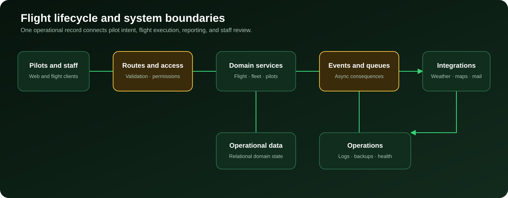

# Air Jamaica Virtual

[](https://airjamaicavirtual.com)
[](https://github.com/aderofrank402-spec/air-jamaica-virtual/actions/workflows/ci.yml)


**A production virtual-airline operations platform connecting pilots, dispatch, fleet management, flight reporting, live operational views, training, and administration.**

Air Jamaica Virtual turns the lifecycle of a simulated airline flight into one connected workflow: pilots discover and bid on flights, operational data feeds dispatch and live maps, completed flights become structured reports, and staff manage the airline through role-aware administrative tools.

> **Production system:** the application is deployed at [airjamaicavirtual.com](https://airjamaicavirtual.com). This public snapshot excludes environment files, production data, uploads, logs, backups, and generated dependencies.

## What this repository demonstrates

| Engineering surface | Evidence in the public snapshot |
|---|---|
| Backend domain | 97 domain models and 35 HTTP controllers |
| User experience | 251 Blade views and 15 operational widgets |
| Application scale | 1,287 tracked PHP source files |
| Quality surface | 25 backend test files plus Composer and frontend build validation |
| Operations | Queues, scheduled jobs, backup tooling, activity logs, diagnostics, and environment-aware configuration |
| Integrations | Flight planning, weather, mapping, identity providers, email transports, object storage, and flight-tracking clients |

These counts describe repository structure; they are not business-activity claims. Operational totals such as flights, destinations, pilots, and fleet activity will be added only with screenshots from the live system.

## Product workflow



1. **Discover** — pilots search the schedule by origin, destination, aircraft, and availability.
2. **Plan** — dispatch and flight-planning data prepare a structured operational brief.
3. **Fly** — live tracking and status views surface active operations.
4. **Report** — completed flights become pilot reports with route, aircraft, time, and operational data.
5. **Review** — authorized staff validate reports, update records, and manage exceptions.
6. **Operate** — dashboards connect fleet, pilots, finance, training, communications, and system health.

## Key capabilities

### Pilot experience

- Pilot registration, authentication, profiles, ranks, awards, and activity history
- Flight search, bidding, briefing, dispatch, and flight-plan workflows
- Pilot-report filing and review status
- Personal statistics, logbook views, notifications, and downloadable records

### Flight operations

- Schedule, route, airport, airline, subfleet, and aircraft management
- Aircraft availability and location constraints
- Live flight maps, airspace views, weather, and active-status widgets
- Dispatch-center, flight-operations-center, and performance dashboards
- Flight imports, exports, and structured API resources

### Administration

- Role- and permission-aware administration
- Pilot roster, report review, fleet, fares, expenses, finance, and settings
- Training content, aircraft documentation, news, pages, and operational notices
- Activity logs, backups, maintenance tools, and application diagnostics

## Architecture

The application follows a layered Laravel architecture:

```text
Browser and flight clients
        │
        ▼
Blade views · JavaScript · Vite assets · API routes
        │
        ▼
Controllers · request validation · authorization
        │
        ▼
Services · repositories · events · listeners · scheduled jobs
        │
        ▼
Eloquent domain models · queues · cache · relational database
        │
        ▼
Weather · maps · planning · identity · mail · storage adapters
```

Read the [architecture guide](docs/ARCHITECTURE.md) for request flows, domain boundaries, and operational components.

## Technology

- **Backend:** PHP 8.2+, Laravel 12, Eloquent, REST resources, events, queues, scheduled jobs
- **Administration:** Filament 4 with role-aware resources and dashboards
- **Frontend:** Blade, JavaScript, Bootstrap, Sass, Leaflet, Vite
- **Data:** MySQL/MariaDB in deployment; isolated in-memory database configuration for tests
- **Integrations:** flight planning, aviation weather, mapping, OAuth identity, transactional email, S3-compatible storage
- **Operations:** Docker/Sail definitions, backup tooling, activity logging, deployment scripts, diagnostics

## Run locally

Requirements: PHP 8.2+, Composer, Node.js 20+, npm, and a supported relational database.

```bash
cp .env.example .env
composer install
php artisan key:generate
npm ci
npm run build
php artisan migrate
php artisan serve
```

Use development-only credentials in `.env`. Never copy production credentials, data, uploads, or backups into a local checkout.

## Verification

```bash
composer validate --no-check-publish
npm ci
npm run build
php vendor/bin/phpunit
php scripts/validate_public_repo.php
```

The frontend production build has been verified locally. The dependency-locked backend suite contains 210 tests and was exercised while preparing this release; failures uncovered during that pass were corrected in database portability, runtime-directory setup, CAPTCHA verification, import/export handling, notification routing, registration behavior, and API compatibility. The Linux CI run is the publication gate of record. The frontend still reports Sass deprecation warnings and runtime-resolved font paths; those warnings are documented rather than hidden.

## Documentation

- [Architecture](docs/ARCHITECTURE.md)
- [Engineering decisions](docs/ENGINEERING_DECISIONS.md)
- [Operations and deployment](docs/OPERATIONS.md)
- [Portfolio evidence checklist](docs/EVIDENCE_CHECKLIST.md)
- [Security policy](SECURITY.md)
- [Changelog](CHANGELOG.md)

## Evidence still to be added

The repository is intentionally waiting for live-system screenshots before publishing operational totals. The next evidence pass will add:

- Operations dashboard with total completed flights and hours
- Route or destinations view showing network breadth
- Live-map or active-flight view
- Fleet or aircraft-management view
- Pilot dashboard or logbook view
- Administrative operations view with sensitive values removed

See the [evidence checklist](docs/EVIDENCE_CHECKLIST.md) for exact capture guidance.

## Security and privacy

No production credentials, personal pilot records, flight-report database, uploads, logs, or backups are included. Please report vulnerabilities privately using the process in [SECURITY.md](SECURITY.md).

## Author

Built and maintained for Air Jamaica Virtual by [Frank Adero](https://github.com/aderofrank402-spec), a backend and AI-agent engineer focused on production systems and dependable automation.
